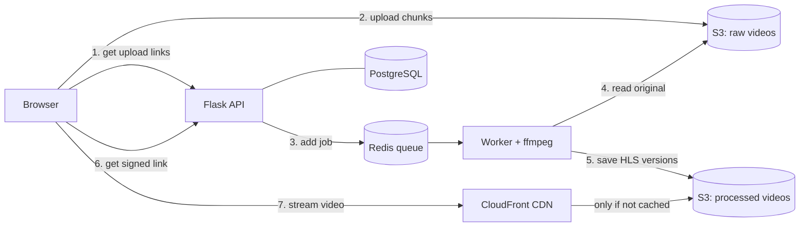

# Cloud-Based Scalable Video Streaming System (StreamForge)

[](https://github.com/Aishwarya0903/Cloud-Based-Scalable-Video-Streaming-System/actions/workflows/ci.yml)

I built this project to learn how video platforms like YouTube or Netflix store and deliver video
to many viewers at once. It's a small video streaming website: you can upload a video, the server
converts it into several qualities, and viewers watch it through a CDN. The player switches quality
automatically depending on their internet speed.

**Built with:** Python, Flask, AWS S3, AWS CloudFront, Boto3, ffmpeg, Redis, PostgreSQL, Docker, Terraform


## What it does

- **Upload videos** straight from the browser to cloud storage (S3), in parallel chunks
- **Convert each video** into 240p, 360p, 480p, 720p and 1080p versions (only up to the original's resolution)
- **Stream videos** with automatic quality switching, the same idea YouTube uses
- **Deliver video through a CDN** (CloudFront) so it loads fast and the server isn't overloaded
- **Protect videos** with links that expire after a few hours
- **Show stats** for each video: views, watch time, how long it took to start, buffering, and which
  parts people actually watched
- Library with search, sorting and a "Trending" tab; login with JWT tokens

## How it works

The whole flow, from uploading a video to someone watching it:

1. **Upload.** The browser asks the Flask API to start an upload. The API returns temporary
   upload links (presigned URLs), and the browser sends the file **directly to S3** in 8 MB chunks,
   4 at a time. The video never passes through the Flask server.
2. **Queue.** When all chunks are in S3, the API checks with S3 that every chunk arrived and the size
   is right, then adds a "convert this video" job to a Redis queue.
3. **Convert.** A worker process downloads the video and uses **ffmpeg** to create the different
   qualities as HLS (small 4-second video segments plus playlist files). It also makes a thumbnail
   and a grid of preview images for the seek bar, then uploads everything to a second S3 bucket.
4. **Watch.** When someone opens a video, the API gives them a **signed link** that expires in
   4 hours. The player (hls.js) downloads the playlist and then the segments through the **CDN**.
5. **Measure.** While the video plays, the player sends small reports back (startup time,
   buffering, quality changes, how far they watched). The API turns these into the stats page.



## Key concepts used

**Presigned URL.** A temporary link generated with Boto3 that lets the browser upload one specific
chunk to S3 without having AWS credentials. It expires after an hour.

**Multipart upload.** S3 lets you upload a big file in pieces and join them at the end. If the
connection drops, only the failed piece is re-sent. My upload page remembers the upload, so choosing
the same file again continues where it stopped.

**HLS and adaptive bitrate.** The video is cut into small segments in several qualities. The player
measures the download speed and picks the best quality that won't buffer. To make switching smooth,
I force a keyframe every 4 seconds in every quality, so the segments line up exactly.

**CDN.** CloudFront keeps copies of the video segments in data centers close to viewers. After the
first viewer, the next ones get the cached copy and S3 isn't touched. Segments never change, so they
are cached for a year; playlists are cached for 60 seconds.

**Signed URLs.** The S3 bucket is private; only CloudFront can read it (Origin Access Control).
Viewers need a link signed by the API, and the signature covers the whole video folder, so one
signature works for every segment. The signature is not part of the cache key, so all viewers still
share the same cached copy.

**Local version of everything.** AWS costs money if you're not careful, so for development I run
**MinIO** (an S3-compatible store) and an **nginx cache** that works like CloudFront, with the same
kind of expiring links. The same code runs against real AWS by changing a few environment variables.

## Tech stack

| Part | What I used |
|---|---|
| Backend | Python, Flask, SQLAlchemy, JWT auth, gunicorn |
| Storage | AWS S3 with Boto3 (MinIO when running locally) |
| CDN | AWS CloudFront (nginx cache locally) |
| Video processing | ffmpeg, Redis + RQ background workers |
| Database | PostgreSQL (SQLite for tests) |
| Frontend | HTML, CSS, JavaScript, hls.js |
| Infrastructure | Terraform, Docker, Docker Compose |
| Monitoring | Prometheus, Grafana |
| Testing | pytest, moto (fake S3 for tests), Locust (load testing), GitHub Actions |

## Running it locally

You need Docker installed. Everything runs locally and is free.

```bash
git clone https://github.com/Aishwarya0903/Cloud-Based-Scalable-Video-Streaming-System.git
cd Cloud-Based-Scalable-Video-Streaming-System
cp .env.example .env
docker compose up --build
```

Then open **http://localhost:8080**, create an account and upload a video.

Optional extras:

```bash
docker compose up --scale worker=4                # more workers to convert videos faster
docker compose --profile observability up         # Prometheus on :9090 and Grafana on :3000
```

The MinIO storage console is at http://localhost:9001 (login `streamforge` / `streamforge-secret`).

## Deploying the AWS part

The `infra/terraform` folder creates the AWS resources: two private S3 buckets, the CloudFront
distribution, the signing key for the signed links, and an IAM policy that only allows access to
those two buckets. It is set up to stay within the AWS Free Tier, and it can create a $1 budget
alert so AWS emails you before you're charged anything.

```bash
cd infra/terraform
terraform init
terraform apply
```

Then I run the app against AWS with `docker-compose.aws.yml`. The script
`scripts/verify_cloudfront.py` checks that CloudFront works as expected: links without a signature
are blocked, S3 can't be read directly, signed links work, and the second request comes from the
cache. All the steps are in [infra/terraform/README.md](infra/terraform/README.md).

## Main API endpoints

| Endpoint | What it does |
|---|---|
| `POST /api/v1/auth/register`, `/login` | Create an account or log in (returns a JWT token) |
| `POST /api/v1/uploads` | Start an upload; returns the chunk size and number of chunks |
| `POST /api/v1/uploads/{id}/parts` | Get presigned upload links for chunks |
| `POST /api/v1/uploads/{id}/complete` | Finish the upload and start converting |
| `GET /api/v1/videos` | List videos (search, sort, pages) |
| `GET /api/v1/videos/{id}/playback` | Get the signed streaming links |
| `POST /api/v1/videos/{id}/events` | Player reports (startup time, buffering, watch time) |
| `GET /api/v1/videos/{id}/stats` | Stats for the video owner |
| `GET /api/v1/trending` | Trending videos |
| `GET /healthz`, `GET /readyz` | Health checks |

## Testing

```bash
pip install -r requirements-dev.txt
pytest
```

There are 60 tests. They use **moto** to fake S3, so no AWS account is needed, and some of them
run real ffmpeg conversions to check the output (all qualities present, correct cache headers).
GitHub Actions runs the tests on every push, plus `terraform validate` and a Docker build.

## Results I measured

I tested everything on one small machine (2 CPUs) that was running all the services and the load
test at the same time, so real servers would do better.

| Test | Result |
|---|---|
| 100 simulated viewers for 60 seconds (Locust) | 17,364 requests, 0 errors, average 289 requests/second |
| Response time in that test | half under 23 ms, 95% under 81 ms |
| Requests served from the CDN cache | 98.7% |
| Video segment: first request vs. cached | 18 ms vs. 2 ms |
| 20 viewers opening the same new video at once | only 5 requests reached the storage |
| Uploading a 24 MB video | 0.8 seconds |
| Converting a 40-second 1080p video into 4 qualities | 89 seconds |
| Time until the video starts playing | about 0.4 to 0.7 seconds |

## Challenges and how I solved them

- **Presigned URLs inside Docker.** Inside Docker the API reaches storage at `minio:9000`, but the
  browser can't, and the hostname is part of the signature. So I use a second Boto3 client that
  signs links for the public address.
- **Smooth quality switching.** If each quality has keyframes in different places, the segments
  don't line up and switching stutters. I force a keyframe every 4 seconds in every quality.
- **CSS and JavaScript returned 404.** Flask's built-in `/static` route was taking over my
  blueprint's `/static` route. I moved the frontend files to `/assets`.
- **nginx refused my config.** A regex with `{36}` inside a `location` block has to be in quotes,
  otherwise nginx reads the `{` as the start of a block.
- **The metrics broke when gunicorn started.** With `preload_app`, the app is loaded before the
  startup hook runs, so the metrics folder didn't exist yet. I create it at the top of the config file.
- **Deleting a video left old data behind.** SQLite doesn't enforce foreign keys by default, so the
  "on delete cascade" never ran. I now delete the related rows explicitly.

## What I would add next

- Run the API and workers on AWS too (for example ECS), not just storage and the CDN
- Encode with H.265 or AV1 to save bandwidth
- Database migrations with Alembic
- Captions and subtitles

## Project structure

```
streamforge/          Flask application
  api/                uploads, videos, analytics
  pipeline/           ffmpeg video conversion
  web/                HTML pages, CSS, JavaScript player and uploader
  auth.py, cdn.py, storage.py, tasks.py, metrics.py
deploy/               nginx, gunicorn, Prometheus and Grafana config
infra/terraform/      AWS setup (S3, CloudFront, IAM)
loadtest/             Locust load test
scripts/              CDN benchmark and CloudFront check
tests/                pytest tests
```
