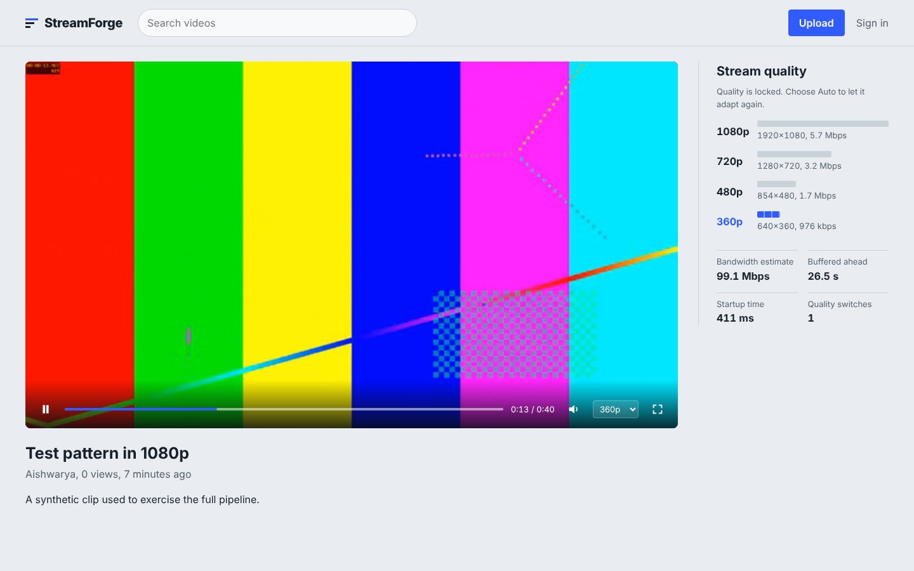
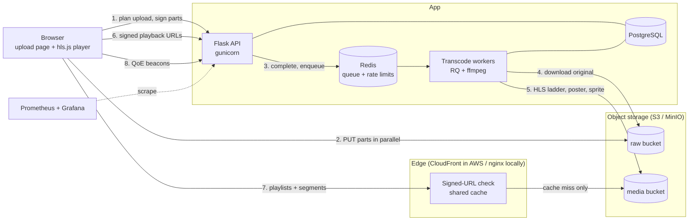

# StreamForge: Cloud-Based Scalable Video Streaming System

[](https://github.com/Aishwarya0903/Cloud-Based-Scalable-Video-Streaming-System/actions/workflows/ci.yml)

A video platform built with **Python/Flask, AWS S3, CloudFront and Boto3**. Browsers upload straight
to S3 in parallel, workers turn each video into an adaptive-bitrate HLS ladder, and viewers stream it
through a CDN using short-lived signed URLs. The player reports quality-of-experience data, so the
platform can measure what viewers actually got.



## Highlights

- **Direct-to-S3, resumable multipart uploads.** The API signs URLs and never touches video bytes. The
  browser sends 4 parts in parallel, retries failures, and resumes after a reload by asking S3 which
  parts it already holds.
- **One decode, many encodes.** A single ffmpeg pass produces an H.264 HLS ladder (1080p to 240p) that
  never upscales. Keyframes are aligned every 4 s across renditions, so quality switches are seamless.
  It also builds a poster and a seek-bar thumbnail sprite with a WebVTT index.
- **CDN delivery with signed URLs.** In production, CloudFront sits in front of a private bucket using
  Origin Access Control, with a wildcard signed policy per video. Locally, an nginx edge cache plays the
  same role with expiring path tokens. In both, the signature is excluded from the cache key, so every
  viewer shares one cached copy.
- **Quality-of-experience analytics.** Startup time, rebuffer ratio, delivered bitrate, quality
  switches, completion rate, an audience-retention curve, and a time-decayed "Trending" ranking.
- **Production basics.** Prometheus metrics and a Grafana dashboard, JSON logs with request IDs,
  Redis-backed rate limits, health and readiness probes, a least-privilege IAM policy, lifecycle cost
  controls, and CI.
- **Free to run.** Every local component is open source, and the AWS side is designed to stay within
  the Free Tier, with an optional $1 budget alarm.

## Architecture



**Upload path:** the API plans part sizes within S3's limits, opens a multipart upload and signs part
URLs in batches. On completion it checks S3's own part list and the total size, so a client can't
forge ETags, and then enqueues a job with a deterministic ID so double submits are harmless.

**Playback path:** the API issues a URL whose signature covers `hls/<video_id>/*`. Playlists reference
segments by relative path, so one signature authorizes the whole video. The edge rejects bad or expired
links (403 / 410) before anything reaches the origin.

## Tech stack

| Layer | Technology |
|---|---|
| API | Python 3.10+, Flask 3, SQLAlchemy 2, PyJWT, Flask-Limiter, gunicorn (gthread) |
| Storage | AWS S3 via Boto3 (MinIO locally): multipart uploads, presigned URLs, lifecycle rules |
| CDN | AWS CloudFront (OAC, signed URLs, cache and response-header policies); nginx edge cache locally |
| Processing | ffmpeg / ffprobe, Redis + RQ workers |
| Database | PostgreSQL (SQLite for tests and quick runs) |
| Frontend | Server-rendered pages, vanilla JS modules, hls.js |
| Infrastructure | Terraform (AWS provider), Docker, Docker Compose |
| Observability | Prometheus client (multi-process), Grafana, JSON logs |
| Quality | pytest + moto (mocked S3) with real ffmpeg transcodes, ruff, GitHub Actions, Locust |

## Quick start

```bash
cp .env.example .env               # optional: set your own secrets
docker compose up --build          # open http://localhost:8080
```

Create an account, upload a video, and watch it once it's ready. Other useful commands:

```bash
docker compose up --scale worker=4                 # more transcode capacity
docker compose --profile observability up          # + Prometheus :9090 and Grafana :3000
open http://localhost:9001                         # MinIO console (streamforge / streamforge-secret)
```

Without Docker, for development and tests:

```bash
python -m venv .venv && . .venv/bin/activate
pip install -r requirements-dev.txt                # needs ffmpeg on PATH for the transcode tests
pytest && ruff check .
```

## Deploy the AWS side (S3 + CloudFront)

`infra/terraform` provisions the private buckets, the CloudFront distribution with Origin Access
Control and signed URLs, cache and response-header policies, lifecycle rules, a least-privilege IAM
policy and an optional budget alarm. To run the app against it:

```bash
cd infra/terraform && terraform init && terraform apply
# fill .env.aws from `terraform output app_env`, then:
docker compose -f docker-compose.yml -f docker-compose.aws.yml --env-file .env.aws up --build
python scripts/verify_cloudfront.py   # unsigned 403, direct S3 403, signed 200, edge cache Hit
```

Step-by-step instructions, cost notes and teardown are in [infra/terraform/README.md](infra/terraform/README.md).

## API

All endpoints are under `/api/v1` and return JSON errors in the form
`{"error": {"code", "message", "details?"}}`.

| Method & path | Auth | Purpose |
|---|---|---|
| `POST /auth/register`, `POST /auth/login`, `GET /auth/me` | – / – / JWT | Accounts (rate-limited) |
| `POST /uploads` | JWT | Plan a multipart upload; returns part size and count |
| `POST /uploads/{id}/parts` | JWT | Sign up to 100 part URLs |
| `GET /uploads/{id}` | JWT | Parts S3 already has (used to resume) |
| `POST /uploads/{id}/complete` / `DELETE /uploads/{id}` | JWT | Finish (verified against S3) and queue, or abort |
| `GET /videos?q=&sort=recent\|popular\|title&page=` | – | Public library |
| `GET /trending` | – | Engagement-weighted, 24 h half-life ranking |
| `GET /me/videos` | JWT | Your videos in every state |
| `GET /videos/{id}` / `PATCH` / `DELETE` | – / owner / owner | Details, edit, delete (removes S3 objects) |
| `GET /videos/{id}/playback` | – | Signed HLS, poster and thumbnail URLs |
| `POST /videos/{id}/retranscode` | owner | Re-run the pipeline from the kept original |
| `POST /videos/{id}/events` | – | Player QoE beacons (`start`, `heartbeat`, `end`) |
| `GET /videos/{id}/stats` | owner | Views, watch time, completion, startup p50/p95, rebuffer ratio, retention |

Operations endpoints: `GET /healthz` (liveness), `GET /readyz` (database and S3 reachable), and
`GET /metrics` (Prometheus format, blocked at the public edge).

## Design decisions

- **Uploads bypass the API.** Presigned multipart uploads let throughput scale with S3, not with API
  workers, and a dropped connection costs one 8 MB part rather than the whole file. Lifecycle rules
  abort abandoned uploads so they don't accrue storage charges.
- **Completion trusts S3, not the client.** The API lists the parts S3 received and checks their count
  and total size before completing the upload.
- **Single-pass ladder.** `split` + `scale` in one ffmpeg process decodes the source once for every
  rendition. Forced keyframes every 4 s give identical segment boundaries across renditions, which is
  what lets the player switch quality mid-stream.
- **Signatures stay out of the cache key.** A wildcard policy (CloudFront) or path token (nginx) per
  video means one signature covers every segment. Excluding it from the cache key keeps the hit ratio
  high, because all viewers share one cached copy.
- **Immutable segments, short-lived playlists.** Segments, posters and sprites are cached for a year;
  `.m3u8` playlists for 60 s, so a re-transcode shows up quickly.
- **QoE beacons are deltas folded into one row per viewing.** That's one upsert per beacon, values are
  clamped so a bad client can't skew the aggregates, and watched 5% slices are stored as a bitmask, so
  the retention curve is a cheap aggregate.
- **Stateless processes.** API and worker replicas scale horizontally. Rate limits live in Redis so
  they hold across replicas, and Prometheus discovers every API replica through DNS.

## Performance (measured)

Measured on a single 2-vCPU Linux container running every service (API, worker, nginx edge, S3
emulator, Redis) plus the load generator, so treat these as conservative lower bounds:

| Scenario | Result |
|---|---|
| Load test: 100 concurrent viewers for 60 s (`loadtest/locustfile.py`) | 17,364 requests, **0 failures**, 289 req/s, p50 23 ms, p95 81 ms |
| Edge cache during the test session | **98.7 % hit ratio** (9,096 media requests, 111 origin fetches) |
| Segment delivery under load | p50 15 ms, p95 53 ms |
| Playlist MISS → HIT / 1.5 MB segment MISS → HIT | 29 ms → 0.7 ms / 18 ms → 2 ms |
| Cold cache, 20 simultaneous viewers | 140 requests collapsed into 5 origin fetches |
| Upload of a 24 MB 1080p file (4 parallel parts) | 0.8 s |
| Transcode 40 s of 1080p → 4-rendition ladder | 89 s (CPU only) |
| Playback start in the browser | 0.4–0.7 s |

## Testing and CI

- **60 pytest tests** run against mocked S3 (moto): auth, upload planning and S3 part limits,
  completion checks, access rules, CDN token compatibility with nginx, CloudFront signature
  verification, analytics math, trending, rate limits, metrics and pages. **Real ffmpeg transcodes**
  confirm the HLS output, aligned renditions and cache headers.
- **GitHub Actions:** ruff and pytest on Python 3.10 and 3.12, `terraform fmt` and `validate`, a Docker
  build, and a Compose config check.
- **End to end:** a Playwright script drove the real UI (sign up, upload, transcode, playback, quality
  lock, analytics), and `scripts/cdn_bench.py` and `scripts/verify_cloudfront.py` check the edge.

## Project structure

```
streamforge/
  api/            uploads (multipart), videos, analytics (QoE, stats, trending)
  pipeline/       ffprobe, ABR ladder selection, ffmpeg HLS + sprite generation
  web/            page templates, CSS, JS (player, uploader, studio, stats), vendored hls.js
  auth.py         JWT auth            cdn.py       signed URLs + origin
  storage.py      Boto3 S3 wrapper    tasks.py     transcode job
  metrics.py      Prometheus, request IDs, JSON logs
deploy/           nginx edge, gunicorn config, Prometheus + Grafana provisioning
infra/terraform/  S3, CloudFront, IAM, budget
loadtest/         Locust scenario
scripts/          CDN benchmark, CloudFront verification
tests/            pytest suite
```

## Notes

- Free-tier details: CloudFront's always-free 1 TB/month covers demo traffic, and S3's 5 GB is free
  for the first 12 months of an account. Check your account's terms, set `budget_email`, and run
  `terraform destroy` after a demo.
- Local S3 uses a pinned MinIO release, because MinIO stopped publishing community images in late
  2025. Any S3-compatible store works through `S3_ENDPOINT_URL`.
- The schema is created on startup, which is enough for a demo; a production rollout would add
  Alembic migrations.
